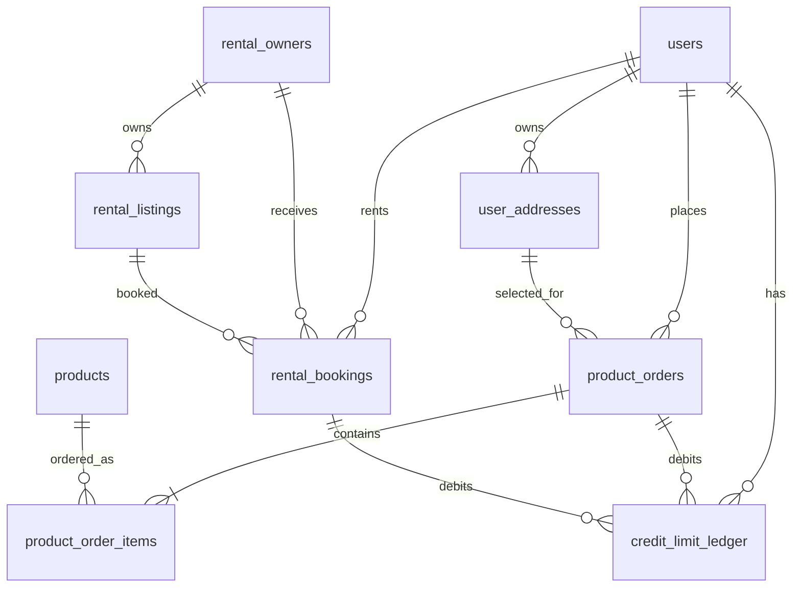

# Database-41 — Struktur Database untuk US-41 FlexiPay

## 1. Ruang Lingkup

Dokumen ini mendefinisikan kebutuhan data khusus US-41 untuk:
- Katalog dan checkout produk.
- Katalog kos/kontrakan.
- Pemilihan durasi sewa 1–12 bulan.
- Penyimpanan alamat penerima.
- Pembelian/booking menggunakan limit FlexiPay.
- Pencatatan pergerakan limit dan referensi WhatsApp pemilik.

Dokumen ini mengasumsikan tabel inti dari user story sebelumnya sudah tersedia, seperti `users`, `credit_accounts` (atau tabel limit pengguna), `transactions`, dan `installment_schedules`. Nama tabel inti harus diselaraskan dengan skema database utama proyek sebelum migration dijalankan.

## 2. Prinsip Relasi

- Satu pengguna dapat memiliki banyak alamat penerima, transaksi, dan booking sewa.
- Satu produk dapat muncul di banyak item transaksi.
- Satu transaksi dapat memiliki beberapa item produk.
- Satu pemilik dapat memiliki banyak listing sewa.
- Satu listing dapat memiliki banyak booking sepanjang periode sewanya tidak bentrok.
- Setiap pembelian/booking yang menggunakan limit harus memiliki catatan ledger limit.
- PIN transaksi berada pada tabel kredensial pengguna yang sudah ada; US-41 tidak membuat salinan PIN baru.

## 3. Tabel yang Dibutuhkan

### 3.1 `products`

| Kolom | Tipe PostgreSQL | Constraint | Keterangan |
|---|---|---|---|
| id | UUID | PK | ID produk |
| name | VARCHAR(160) | NOT NULL | Nama produk |
| slug | VARCHAR(180) | UNIQUE, NOT NULL | Slug produk |
| category | VARCHAR(80) | NOT NULL | Kategori produk |
| description | TEXT | NULL | Deskripsi |
| image_url | TEXT | NULL | URL gambar produk |
| price | NUMERIC(14,2) | NOT NULL, CHECK price >= 0 | Harga produk |
| stock_quantity | INTEGER | NOT NULL DEFAULT 0, CHECK >= 0 | Stok |
| is_active | BOOLEAN | NOT NULL DEFAULT TRUE | Status produk |
| created_at | TIMESTAMPTZ | NOT NULL DEFAULT NOW() | Waktu dibuat |
| updated_at | TIMESTAMPTZ | NOT NULL DEFAULT NOW() | Waktu diperbarui |

### 3.2 `user_addresses`

| Kolom | Tipe PostgreSQL | Constraint | Keterangan |
|---|---|---|---|
| id | UUID | PK | ID alamat |
| user_id | UUID | FK → users.id, NOT NULL | Pemilik alamat |
| recipient_name | VARCHAR(150) | NOT NULL | Nama penerima |
| phone_number | VARCHAR(25) | NOT NULL | Nomor telepon aktif |
| email | VARCHAR(255) | NOT NULL | Email penerima |
| address_line | TEXT | NOT NULL | Alamat lengkap |
| province | VARCHAR(100) | NULL | Provinsi |
| city | VARCHAR(100) | NULL | Kota/kabupaten |
| district | VARCHAR(100) | NULL | Kecamatan |
| village | VARCHAR(100) | NULL | Kelurahan/desa |
| postal_code | VARCHAR(10) | NOT NULL | Kode pos |
| is_default | BOOLEAN | NOT NULL DEFAULT FALSE | Alamat utama |
| created_at | TIMESTAMPTZ | NOT NULL DEFAULT NOW() | Waktu dibuat |
| updated_at | TIMESTAMPTZ | NOT NULL DEFAULT NOW() | Waktu diperbarui |

### 3.3 `product_orders`

| Kolom | Tipe PostgreSQL | Constraint | Keterangan |
|---|---|---|---|
| id | UUID | PK | ID pesanan |
| user_id | UUID | FK → users.id, NOT NULL | Pembeli |
| address_id | UUID | FK → user_addresses.id, NULL | Alamat yang dipilih |
| order_number | VARCHAR(40) | UNIQUE, NOT NULL | Nomor pesanan |
| recipient_name | VARCHAR(150) | NOT NULL | Snapshot nama penerima |
| recipient_phone | VARCHAR(25) | NOT NULL | Snapshot nomor HP |
| recipient_email | VARCHAR(255) | NOT NULL | Snapshot email |
| shipping_address | TEXT | NOT NULL | Snapshot alamat |
| postal_code | VARCHAR(10) | NOT NULL | Snapshot kode pos |
| subtotal | NUMERIC(14,2) | NOT NULL, CHECK >= 0 | Total item |
| fees | NUMERIC(14,2) | NOT NULL DEFAULT 0, CHECK >= 0 | Biaya tambahan |
| total_amount | NUMERIC(14,2) | NOT NULL, CHECK >= 0 | Total pembelian |
| status | VARCHAR(24) | NOT NULL | pending, confirmed, processing, completed, cancelled, failed |
| idempotency_key | VARCHAR(100) | UNIQUE, NOT NULL | Pencegah request ganda |
| created_at | TIMESTAMPTZ | NOT NULL DEFAULT NOW() | Waktu dibuat |
| updated_at | TIMESTAMPTZ | NOT NULL DEFAULT NOW() | Waktu diperbarui |

### 3.4 `product_order_items`

| Kolom | Tipe PostgreSQL | Constraint | Keterangan |
|---|---|---|---|
| id | UUID | PK | ID item |
| order_id | UUID | FK → product_orders.id, NOT NULL | Pesanan |
| product_id | UUID | FK → products.id, NOT NULL | Produk |
| product_name_snapshot | VARCHAR(160) | NOT NULL | Nama saat pembelian |
| unit_price | NUMERIC(14,2) | NOT NULL, CHECK >= 0 | Harga satuan saat checkout |
| quantity | INTEGER | NOT NULL, CHECK quantity > 0 | Jumlah |
| line_total | NUMERIC(14,2) | NOT NULL, CHECK >= 0 | Total item |

### 3.5 `rental_owners`

| Kolom | Tipe PostgreSQL | Constraint | Keterangan |
|---|---|---|---|
| id | UUID | PK | ID pemilik |
| user_id | UUID | FK → users.id, NULL | Akun FlexiPay pemilik jika tersedia |
| owner_name | VARCHAR(150) | NOT NULL | Nama pemilik |
| phone_number | VARCHAR(25) | NOT NULL | Nomor kontak |
| whatsapp_number | VARCHAR(20) | NOT NULL | Nomor format internasional untuk wa.me |
| email | VARCHAR(255) | NULL | Email pemilik |
| created_at | TIMESTAMPTZ | NOT NULL DEFAULT NOW() | Waktu dibuat |
| updated_at | TIMESTAMPTZ | NOT NULL DEFAULT NOW() | Waktu diperbarui |

### 3.6 `rental_listings`

| Kolom | Tipe PostgreSQL | Constraint | Keterangan |
|---|---|---|---|
| id | UUID | PK | ID listing |
| owner_id | UUID | FK → rental_owners.id, NOT NULL | Pemilik properti |
| title | VARCHAR(180) | NOT NULL | Nama kos/kontrakan |
| property_type | VARCHAR(20) | NOT NULL | kos atau kontrakan |
| description | TEXT | NULL | Deskripsi |
| address_line | TEXT | NOT NULL | Alamat properti |
| city | VARCHAR(100) | NOT NULL | Kota/kabupaten |
| province | VARCHAR(100) | NOT NULL | Provinsi |
| postal_code | VARCHAR(10) | NULL | Kode pos |
| monthly_price | NUMERIC(14,2) | NOT NULL, CHECK > 0 | Harga per bulan |
| image_url | TEXT | NULL | Foto utama |
| availability_status | VARCHAR(20) | NOT NULL | available, unavailable, inactive |
| is_active | BOOLEAN | NOT NULL DEFAULT TRUE | Status tayang |
| created_at | TIMESTAMPTZ | NOT NULL DEFAULT NOW() | Waktu dibuat |
| updated_at | TIMESTAMPTZ | NOT NULL DEFAULT NOW() | Waktu diperbarui |

### 3.7 `rental_bookings`

| Kolom | Tipe PostgreSQL | Constraint | Keterangan |
|---|---|---|---|
| id | UUID | PK | ID booking |
| user_id | UUID | FK → users.id, NOT NULL | Penyewa |
| listing_id | UUID | FK → rental_listings.id, NOT NULL | Listing yang disewa |
| owner_id | UUID | FK → rental_owners.id, NOT NULL | Snapshot relasi pemilik |
| booking_number | VARCHAR(40) | UNIQUE, NOT NULL | Nomor booking |
| duration_months | SMALLINT | NOT NULL, CHECK BETWEEN 1 AND 12 | Durasi 1–12 bulan |
| monthly_price_snapshot | NUMERIC(14,2) | NOT NULL, CHECK > 0 | Harga per bulan saat booking |
| total_amount | NUMERIC(14,2) | NOT NULL, CHECK >= 0 | Total biaya sewa |
| start_date | DATE | NULL | Tanggal mulai sesuai kesepakatan |
| end_date | DATE | NULL | Tanggal selesai |
| owner_name_snapshot | VARCHAR(150) | NOT NULL | Nama pemilik saat booking |
| owner_phone_snapshot | VARCHAR(25) | NOT NULL | Nomor telepon saat booking |
| owner_whatsapp_snapshot | VARCHAR(20) | NOT NULL | WhatsApp saat booking |
| property_address_snapshot | TEXT | NOT NULL | Alamat saat booking |
| status | VARCHAR(24) | NOT NULL | pending, confirmed, active, completed, cancelled, failed |
| idempotency_key | VARCHAR(100) | UNIQUE, NOT NULL | Pencegah booking ganda |
| created_at | TIMESTAMPTZ | NOT NULL DEFAULT NOW() | Waktu dibuat |
| updated_at | TIMESTAMPTZ | NOT NULL DEFAULT NOW() | Waktu diperbarui |

### 3.8 `credit_limit_ledger`

| Kolom | Tipe PostgreSQL | Constraint | Keterangan |
|---|---|---|---|
| id | UUID | PK | ID pergerakan limit |
| user_id | UUID | FK → users.id, NOT NULL | Pemilik limit |
| transaction_id | UUID | FK → transactions.id, NULL | Referensi transaksi produk jika tabel transaksi inti tersedia |
| product_order_id | UUID | FK → product_orders.id, NULL | Referensi pesanan produk |
| rental_booking_id | UUID | FK → rental_bookings.id, NULL | Referensi booking sewa |
| entry_type | VARCHAR(20) | NOT NULL | purchase, rental, repayment, refund, adjustment |
| amount | NUMERIC(14,2) | NOT NULL, CHECK amount > 0 | Nilai pergerakan |
| direction | VARCHAR(10) | NOT NULL | debit atau credit |
| balance_after | NUMERIC(14,2) | NULL, CHECK >= 0 | Sisa limit setelah pergerakan |
| reference_number | VARCHAR(40) | NOT NULL | Referensi bisnis |
| created_at | TIMESTAMPTZ | NOT NULL DEFAULT NOW() | Waktu dicatat |

> Catatan: sesuaikan FK `transactions.id` dengan nama tabel transaksi inti yang benar. Terapkan constraint agar satu ledger hanya merujuk ke satu sumber transaksi (order atau rental booking atau transaksi inti) sesuai desain final.

## 4. Relasi Antar Tabel



## 5. Contoh SQL DDL (PostgreSQL)

> DDL berikut adalah baseline untuk tabel baru US-41. Pastikan tabel `users` dan tabel inti lain sudah ada sebelum menjalankan migration. Kolom dan nama tabel inti perlu diselaraskan dengan database FlexiPay yang sudah dibuat.

```sql
CREATE TABLE products (
  id UUID PRIMARY KEY DEFAULT gen_random_uuid(),
  name VARCHAR(160) NOT NULL,
  slug VARCHAR(180) NOT NULL UNIQUE,
  category VARCHAR(80) NOT NULL,
  description TEXT,
  image_url TEXT,
  price NUMERIC(14,2) NOT NULL CHECK (price >= 0),
  stock_quantity INTEGER NOT NULL DEFAULT 0 CHECK (stock_quantity >= 0),
  is_active BOOLEAN NOT NULL DEFAULT TRUE,
  created_at TIMESTAMPTZ NOT NULL DEFAULT NOW(),
  updated_at TIMESTAMPTZ NOT NULL DEFAULT NOW()
);

CREATE TABLE user_addresses (
  id UUID PRIMARY KEY DEFAULT gen_random_uuid(),
  user_id UUID NOT NULL REFERENCES users(id),
  recipient_name VARCHAR(150) NOT NULL,
  phone_number VARCHAR(25) NOT NULL,
  email VARCHAR(255) NOT NULL,
  address_line TEXT NOT NULL,
  province VARCHAR(100),
  city VARCHAR(100),
  district VARCHAR(100),
  village VARCHAR(100),
  postal_code VARCHAR(10) NOT NULL,
  is_default BOOLEAN NOT NULL DEFAULT FALSE,
  created_at TIMESTAMPTZ NOT NULL DEFAULT NOW(),
  updated_at TIMESTAMPTZ NOT NULL DEFAULT NOW()
);

CREATE TABLE product_orders (
  id UUID PRIMARY KEY DEFAULT gen_random_uuid(),
  user_id UUID NOT NULL REFERENCES users(id),
  address_id UUID REFERENCES user_addresses(id),
  order_number VARCHAR(40) NOT NULL UNIQUE,
  recipient_name VARCHAR(150) NOT NULL,
  recipient_phone VARCHAR(25) NOT NULL,
  recipient_email VARCHAR(255) NOT NULL,
  shipping_address TEXT NOT NULL,
  postal_code VARCHAR(10) NOT NULL,
  subtotal NUMERIC(14,2) NOT NULL CHECK (subtotal >= 0),
  fees NUMERIC(14,2) NOT NULL DEFAULT 0 CHECK (fees >= 0),
  total_amount NUMERIC(14,2) NOT NULL CHECK (total_amount >= 0),
  status VARCHAR(24) NOT NULL CHECK (status IN
    ('pending','confirmed','processing','completed','cancelled','failed')),
  idempotency_key VARCHAR(100) NOT NULL UNIQUE,
  created_at TIMESTAMPTZ NOT NULL DEFAULT NOW(),
  updated_at TIMESTAMPTZ NOT NULL DEFAULT NOW()
);

CREATE TABLE product_order_items (
  id UUID PRIMARY KEY DEFAULT gen_random_uuid(),
  order_id UUID NOT NULL REFERENCES product_orders(id) ON DELETE CASCADE,
  product_id UUID NOT NULL REFERENCES products(id),
  product_name_snapshot VARCHAR(160) NOT NULL,
  unit_price NUMERIC(14,2) NOT NULL CHECK (unit_price >= 0),
  quantity INTEGER NOT NULL CHECK (quantity > 0),
  line_total NUMERIC(14,2) NOT NULL CHECK (line_total >= 0)
);

CREATE TABLE rental_owners (
  id UUID PRIMARY KEY DEFAULT gen_random_uuid(),
  user_id UUID REFERENCES users(id),
  owner_name VARCHAR(150) NOT NULL,
  phone_number VARCHAR(25) NOT NULL,
  whatsapp_number VARCHAR(20) NOT NULL,
  email VARCHAR(255),
  created_at TIMESTAMPTZ NOT NULL DEFAULT NOW(),
  updated_at TIMESTAMPTZ NOT NULL DEFAULT NOW()
);

CREATE TABLE rental_listings (
  id UUID PRIMARY KEY DEFAULT gen_random_uuid(),
  owner_id UUID NOT NULL REFERENCES rental_owners(id),
  title VARCHAR(180) NOT NULL,
  property_type VARCHAR(20) NOT NULL CHECK (property_type IN ('kos','kontrakan')),
  description TEXT,
  address_line TEXT NOT NULL,
  city VARCHAR(100) NOT NULL,
  province VARCHAR(100) NOT NULL,
  postal_code VARCHAR(10),
  monthly_price NUMERIC(14,2) NOT NULL CHECK (monthly_price > 0),
  image_url TEXT,
  availability_status VARCHAR(20) NOT NULL DEFAULT 'available'
    CHECK (availability_status IN ('available','unavailable','inactive')),
  is_active BOOLEAN NOT NULL DEFAULT TRUE,
  created_at TIMESTAMPTZ NOT NULL DEFAULT NOW(),
  updated_at TIMESTAMPTZ NOT NULL DEFAULT NOW()
);

CREATE TABLE rental_bookings (
  id UUID PRIMARY KEY DEFAULT gen_random_uuid(),
  user_id UUID NOT NULL REFERENCES users(id),
  listing_id UUID NOT NULL REFERENCES rental_listings(id),
  owner_id UUID NOT NULL REFERENCES rental_owners(id),
  booking_number VARCHAR(40) NOT NULL UNIQUE,
  duration_months SMALLINT NOT NULL CHECK (duration_months BETWEEN 1 AND 12),
  monthly_price_snapshot NUMERIC(14,2) NOT NULL CHECK (monthly_price_snapshot > 0),
  total_amount NUMERIC(14,2) NOT NULL CHECK (total_amount >= 0),
  start_date DATE,
  end_date DATE,
  owner_name_snapshot VARCHAR(150) NOT NULL,
  owner_phone_snapshot VARCHAR(25) NOT NULL,
  owner_whatsapp_snapshot VARCHAR(20) NOT NULL,
  property_address_snapshot TEXT NOT NULL,
  status VARCHAR(24) NOT NULL CHECK (status IN
    ('pending','confirmed','active','completed','cancelled','failed')),
  idempotency_key VARCHAR(100) NOT NULL UNIQUE,
  created_at TIMESTAMPTZ NOT NULL DEFAULT NOW(),
  updated_at TIMESTAMPTZ NOT NULL DEFAULT NOW()
);

CREATE TABLE credit_limit_ledger (
  id UUID PRIMARY KEY DEFAULT gen_random_uuid(),
  user_id UUID NOT NULL REFERENCES users(id),
  transaction_id UUID,
  product_order_id UUID REFERENCES product_orders(id),
  rental_booking_id UUID REFERENCES rental_bookings(id),
  entry_type VARCHAR(20) NOT NULL CHECK
    (entry_type IN ('purchase','rental','repayment','refund','adjustment')),
  amount NUMERIC(14,2) NOT NULL CHECK (amount > 0),
  direction VARCHAR(10) NOT NULL CHECK (direction IN ('debit','credit')),
  balance_after NUMERIC(14,2) CHECK (balance_after >= 0),
  reference_number VARCHAR(40) NOT NULL,
  created_at TIMESTAMPTZ NOT NULL DEFAULT NOW(),
  CHECK (num_nonnulls(transaction_id, product_order_id, rental_booking_id) = 1)
);

CREATE INDEX idx_products_active_category ON products(is_active, category);
CREATE INDEX idx_user_addresses_user ON user_addresses(user_id);
CREATE INDEX idx_product_orders_user_created ON product_orders(user_id, created_at DESC);
CREATE INDEX idx_rental_listings_search ON rental_listings(is_active, availability_status, property_type);
CREATE INDEX idx_rental_bookings_user_created ON rental_bookings(user_id, created_at DESC);
CREATE INDEX idx_credit_ledger_user_created ON credit_limit_ledger(user_id, created_at DESC);
```

## 6. Proses Transaksi dan Pengurangan Limit

Pembelian produk dan booking sewa harus dilakukan di dalam satu database transaction:

1. Mulai database transaction.
2. Kunci baris akun limit pengguna (`SELECT ... FOR UPDATE`) agar dua checkout bersamaan tidak memakai limit yang sama.
3. Ambil harga produk/listing dari database dan validasi ulang stok/ketersediaan.
4. Hitung ulang total.
5. Verifikasi PIN di backend menggunakan hash tersimpan.
6. Bandingkan total dengan limit tersedia.
7. Jika limit kurang, rollback dan kirim respons `LIMIT_INSUFFICIENT`.
8. Jika cukup, buat order atau booking.
9. Catat debit pada `credit_limit_ledger` dan perbarui saldo/limit sesuai skema akun limit inti.
10. Commit.
11. Untuk booking sewa, setelah commit berikan tautan WhatsApp pemilik.

**Penting:** Jangan mengurangi limit sebelum seluruh validasi lolos. Jika penyimpanan order/booking gagal, debit limit juga harus rollback. Terapkan idempotency key untuk mencegah pengurangan limit ganda.

## 7. Perhitungan

### Produk
`total_produk = SUM(harga_produk_server × quantity) + biaya`

### Rent Now, Pay Later
`total_sewa = harga_bulanan_server × duration_months + biaya`

Validasi:
- `duration_months >= 1`
- `duration_months <= 12`
- `total_sewa <= available_limit`

## 8. WhatsApp Pemilik

Gunakan nilai `owner_whatsapp_snapshot` dari booking yang berhasil. Normalisasikan nomor ke format internasional tanpa `+`, spasi, atau tanda baca.

Contoh pola URL:
`https://wa.me/62812XXXXXXXX?text=Halo%2C%20saya%20sudah%20melakukan%20booking%20FlexiPay%20dengan%20referensi%20...`

Jangan membuka tautan WhatsApp sebelum booking sukses.

## 9. Catatan Integrasi dengan Database Sebelumnya

Sebelum migration:
- Cocokkan nama tabel `users`, akun limit, transaksi, dan jadwal cicilan dengan implementasi yang sudah ada.
- Jika `transactions` sudah menjadi tabel induk semua transaksi, gunakan relasi tersebut secara konsisten dan hindari menyimpan transaksi yang sama dua kali.
- Jika tabel alamat pengguna sudah tersedia, gunakan tabel yang sudah ada dan tambahkan kolom yang kurang.
- Jangan membuat kolom PIN baru di tabel US-41. Gunakan mekanisme PIN dari US-20/US-39.
- Jadwal cicilan dibuat melalui modul cicilan yang sudah ada setelah transaksi pembiayaan disetujui sesuai aturan produk FlexiPay.
