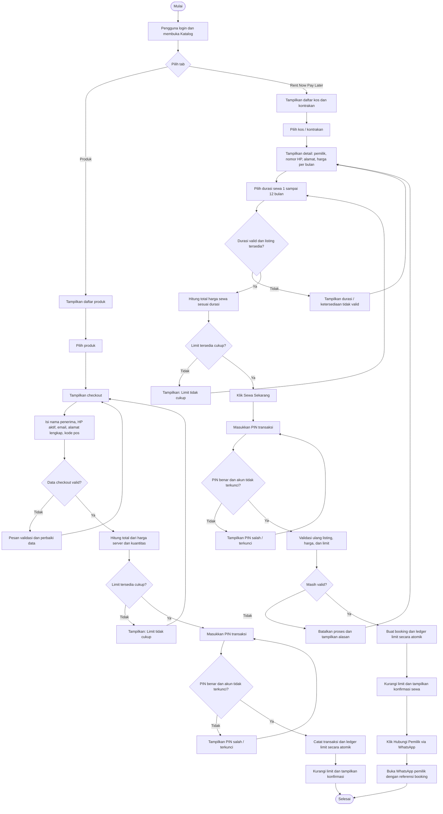

# UF-41 — User Flow Katalog Produk dan Rent Now, Pay Later

**User Story:** US-41 — Tampilan Pilihan Produk dan Tampilan Pilihan Rent Now Pay Later

## Tujuan
Menggambarkan dua jalur transaksi dalam katalog FlexiPay: pembelian produk dengan alamat penerima dan penyewaan kos/kontrakan selama 1–12 bulan. Kedua jalur menggunakan limit FlexiPay dan konfirmasi PIN.

## 1. Flowchart Mermaid

## 2. Ringkasan Jalur Produk

1. Katalog → Produk.
2. Pilih produk.
3. Isi nama penerima, nomor telepon aktif, email, alamat lengkap, dan kode pos.
4. Validasi data dan hitung total transaksi.
5. Periksa limit.
6. Jika limit tidak cukup, tampilkan pesan **“Limit tidak cukup”** dan hentikan proses.
7. Jika limit cukup, minta PIN.
8. Verifikasi PIN di backend.
9. Jika valid, simpan transaksi dan pengurangan limit dalam satu database transaction.
10. Tampilkan konfirmasi.

## 3. Ringkasan Jalur Rent Now, Pay Later

1. Katalog → Rent Now, Pay Later.
2. Pilih kos/kontrakan.
3. Lihat detail pemilik, nomor telepon, alamat, dan harga per bulan.
4. Pilih durasi sewa 1–12 bulan.
5. Hitung total biaya dan periksa ketersediaan serta limit.
6. Jika limit tidak cukup, tampilkan **“Limit tidak cukup”**.
7. Jika cukup, klik **Sewa Sekarang** dan masukkan PIN.
8. Backend memvalidasi ulang harga, ketersediaan, PIN, dan limit.
9. Jika valid, simpan booking dan pengurangan limit secara atomik.
10. Tampilkan konfirmasi dan tombol WhatsApp pemilik.

## 4. Titik Validasi Penting

- Harga dan limit dihitung ulang di backend pada saat konfirmasi.
- PIN diverifikasi menggunakan hash PIN tersimpan; PIN asli tidak disimpan atau dicatat.
- Pengurangan limit dan penyimpanan transaksi/booking harus atomik.
- Permintaan berulang menggunakan idempotency key agar tidak terjadi transaksi ganda.
- WhatsApp pemilik baru dapat dibuka setelah booking berhasil.
