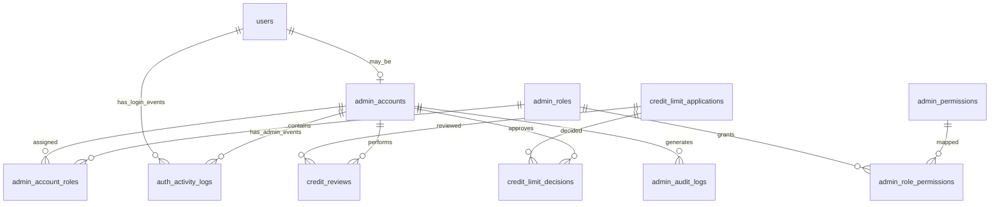

# Database-42 — Struktur Database untuk US-42 Halaman Admin FlexiPay

## 1. Ruang Lingkup

Database US-42 mendukung:
- Akun admin internal dan role/permission.
- Pencatatan aktivitas registrasi dan login pengguna.
- Monitoring daftar pengguna.
- Review pengajuan limit kredit.
- Catatan hasil penilaian dan keputusan admin.
- Penetapan nominal limit.
- Audit trail aktivitas admin.
- Notifikasi keputusan.

Dokumen ini mengasumsikan tabel inti `users`, `credit_accounts` (atau tabel limit pengguna), `credit_limit_applications` (pengajuan limit), `identity_verifications`, dan `notifications` mungkin sudah dibuat pada user story sebelumnya. Sebelum migration, cocokkan nama/kolom dengan database utama FlexiPay dan gunakan tabel yang sudah ada bila fungsinya sama.

## 2. Prinsip Desain

1. Akun admin menggunakan identitas pengguna internal atau tabel admin terpisah, tetapi otorisasi wajib menggunakan role/permission di backend.
2. Tidak ada pembuatan akun admin melalui registrasi publik.
3. Log autentikasi tidak menyimpan password, PIN, OTP, atau token.
4. Data penilaian disimpan terpisah dari profil pengguna agar histori review dapat ditelusuri.
5. Keputusan limit menyimpan nominal, status, admin pengambil keputusan, waktu, dan alasan.
6. Perubahan penting dicatat pada audit trail.
7. Data pribadi dan dokumen dibatasi berdasarkan permission.

## 3. Tabel yang Dibutuhkan

### 3.1 `admin_accounts`

| Kolom | Tipe PostgreSQL | Constraint | Keterangan |
|---|---|---|---|
| id | UUID | PK | ID akun admin |
| user_id | UUID | FK → users.id, UNIQUE, NULL | Relasi jika admin memakai tabel users |
| full_name | VARCHAR(150) | NOT NULL | Nama admin |
| email | VARCHAR(255) | UNIQUE, NOT NULL | Email admin |
| password_hash | TEXT | NOT NULL | Hash password, bukan plaintext |
| status | VARCHAR(20) | NOT NULL | active, inactive, locked |
| mfa_enabled | BOOLEAN | NOT NULL DEFAULT FALSE | Status MFA |
| last_login_at | TIMESTAMPTZ | NULL | Login terakhir |
| created_at | TIMESTAMPTZ | NOT NULL DEFAULT NOW() | Waktu dibuat |
| updated_at | TIMESTAMPTZ | NOT NULL DEFAULT NOW() | Waktu diperbarui |

### 3.2 `admin_roles`

| Kolom | Tipe PostgreSQL | Constraint | Keterangan |
|---|---|---|---|
| id | UUID | PK | ID role |
| role_code | VARCHAR(50) | UNIQUE, NOT NULL | admin_viewer, credit_reviewer, credit_approver, super_admin |
| role_name | VARCHAR(100) | NOT NULL | Nama role |
| description | TEXT | NULL | Deskripsi kewenangan |

### 3.3 `admin_permissions`

| Kolom | Tipe PostgreSQL | Constraint | Keterangan |
|---|---|---|---|
| id | UUID | PK | ID permission |
| permission_code | VARCHAR(80) | UNIQUE, NOT NULL | Kode permission |
| description | TEXT | NULL | Deskripsi aksi yang diizinkan |

### 3.4 `admin_account_roles`

| Kolom | Tipe PostgreSQL | Constraint | Keterangan |
|---|---|---|---|
| admin_id | UUID | FK → admin_accounts.id | Akun admin |
| role_id | UUID | FK → admin_roles.id | Role |
| assigned_by | UUID | FK → admin_accounts.id, NULL | Admin pemberi role |
| assigned_at | TIMESTAMPTZ | NOT NULL DEFAULT NOW() | Waktu pemberian |
| | | PK (admin_id, role_id) | Kombinasi unik |

### 3.5 `admin_role_permissions`

| Kolom | Tipe PostgreSQL | Constraint | Keterangan |
|---|---|---|---|
| role_id | UUID | FK → admin_roles.id | Role |
| permission_id | UUID | FK → admin_permissions.id | Permission |
| | | PK (role_id, permission_id) | Kombinasi unik |

### 3.6 `auth_activity_logs`

| Kolom | Tipe PostgreSQL | Constraint | Keterangan |
|---|---|---|---|
| id | UUID | PK | ID log |
| user_id | UUID | FK → users.id, NULL | Pengguna biasa jika login pengguna |
| admin_id | UUID | FK → admin_accounts.id, NULL | Admin jika login admin |
| event_type | VARCHAR(30) | NOT NULL | login_success, login_failed, logout, session_expired, account_locked |
| occurred_at | TIMESTAMPTZ | NOT NULL DEFAULT NOW() | Waktu kejadian |
| ip_address | INET | NULL | IP jika dikumpulkan |
| user_agent | TEXT | NULL | Browser/perangkat |
| channel | VARCHAR(30) | NULL | web, mobile, admin_portal |
| failure_reason_code | VARCHAR(50) | NULL | Kode alasan umum, tanpa rahasia |
| request_id | VARCHAR(100) | NULL | ID korelasi request |

**Penting:** jangan menyimpan password, PIN, OTP, session cookie, access token, atau isi kredensial pada tabel log.

### 3.7 `credit_reviews`

| Kolom | Tipe PostgreSQL | Constraint | Keterangan |
|---|---|---|---|
| id | UUID | PK | ID review |
| application_id | UUID | FK → credit_limit_applications.id, NOT NULL | Pengajuan yang diperiksa |
| reviewer_admin_id | UUID | FK → admin_accounts.id, NOT NULL | Admin pemeriksa |
| review_status | VARCHAR(30) | NOT NULL | in_review, needs_revision, eligible, not_eligible |
| identity_check_status | VARCHAR(20) | NULL | pending, verified, rejected |
| document_check_status | VARCHAR(20) | NULL | pending, complete, incomplete |
| income_assessment | TEXT | NULL | Ringkasan penilaian penghasilan |
| obligation_assessment | TEXT | NULL | Ringkasan kewajiban berjalan |
| transaction_assessment | TEXT | NULL | Ringkasan histori transaksi jika tersedia |
| assessment_notes | TEXT | NULL | Catatan pemeriksa |
| revision_reason | TEXT | NULL | Kekurangan/perbaikan yang diminta |
| reviewed_at | TIMESTAMPTZ | NULL | Waktu review |
| created_at | TIMESTAMPTZ | NOT NULL DEFAULT NOW() | Waktu dibuat |

### 3.8 `credit_limit_decisions`

| Kolom | Tipe PostgreSQL | Constraint | Keterangan |
|---|---|---|---|
| id | UUID | PK | ID keputusan |
| application_id | UUID | FK → credit_limit_applications.id, NOT NULL | Pengajuan terkait |
| review_id | UUID | FK → credit_reviews.id, NULL | Review pendukung |
| decision_admin_id | UUID | FK → admin_accounts.id, NOT NULL | Admin approver |
| decision_status | VARCHAR(20) | NOT NULL | approved, rejected |
| approved_limit | NUMERIC(14,2) | NULL, CHECK >= 0 | Nominal limit disetujui |
| decision_reason | TEXT | NOT NULL | Alasan keputusan |
| policy_version | VARCHAR(50) | NULL | Versi kebijakan yang digunakan |
| decided_at | TIMESTAMPTZ | NOT NULL DEFAULT NOW() | Waktu keputusan |

Untuk `decision_status='approved'`, `approved_limit` wajib diisi dan harus sesuai parameter kebijakan. Untuk `rejected`, nominal limit harus NULL atau 0 sesuai standar sistem.

### 3.9 `admin_audit_logs`

| Kolom | Tipe PostgreSQL | Constraint | Keterangan |
|---|---|---|---|
| id | UUID | PK | ID audit |
| admin_id | UUID | FK → admin_accounts.id, NOT NULL | Pelaku |
| action | VARCHAR(80) | NOT NULL | Aksi yang dilakukan |
| entity_type | VARCHAR(80) | NOT NULL | users, application, credit_limit, document, admin |
| entity_id | UUID | NULL | ID objek |
| before_data | JSONB | NULL | Ringkasan data sebelum perubahan |
| after_data | JSONB | NULL | Ringkasan data sesudah perubahan |
| reason | TEXT | NULL | Alasan perubahan |
| ip_address | INET | NULL | IP admin |
| created_at | TIMESTAMPTZ | NOT NULL DEFAULT NOW() | Waktu aksi |

Hindari memasukkan password, PIN, OTP, token, atau dokumen mentah ke `before_data`/`after_data`. Batasi akses dan pertimbangkan penyimpanan append-only.

## 4. Relasi Antar Tabel



## 5. Contoh SQL DDL PostgreSQL

> DDL ini merupakan baseline. Pastikan tabel `users` dan `credit_limit_applications` sudah tersedia, lalu sesuaikan tipe/relasi dengan schema FlexiPay yang sudah ada.

```sql
CREATE TABLE admin_accounts (
  id UUID PRIMARY KEY DEFAULT gen_random_uuid(),
  user_id UUID UNIQUE REFERENCES users(id),
  full_name VARCHAR(150) NOT NULL,
  email VARCHAR(255) NOT NULL UNIQUE,
  password_hash TEXT NOT NULL,
  status VARCHAR(20) NOT NULL DEFAULT 'active'
    CHECK (status IN ('active','inactive','locked')),
  mfa_enabled BOOLEAN NOT NULL DEFAULT FALSE,
  last_login_at TIMESTAMPTZ,
  created_at TIMESTAMPTZ NOT NULL DEFAULT NOW(),
  updated_at TIMESTAMPTZ NOT NULL DEFAULT NOW()
);

CREATE TABLE admin_roles (
  id UUID PRIMARY KEY DEFAULT gen_random_uuid(),
  role_code VARCHAR(50) NOT NULL UNIQUE,
  role_name VARCHAR(100) NOT NULL,
  description TEXT
);

CREATE TABLE admin_permissions (
  id UUID PRIMARY KEY DEFAULT gen_random_uuid(),
  permission_code VARCHAR(80) NOT NULL UNIQUE,
  description TEXT
);

CREATE TABLE admin_account_roles (
  admin_id UUID NOT NULL REFERENCES admin_accounts(id),
  role_id UUID NOT NULL REFERENCES admin_roles(id),
  assigned_by UUID REFERENCES admin_accounts(id),
  assigned_at TIMESTAMPTZ NOT NULL DEFAULT NOW(),
  PRIMARY KEY (admin_id, role_id)
);

CREATE TABLE admin_role_permissions (
  role_id UUID NOT NULL REFERENCES admin_roles(id),
  permission_id UUID NOT NULL REFERENCES admin_permissions(id),
  PRIMARY KEY (role_id, permission_id)
);

CREATE TABLE auth_activity_logs (
  id UUID PRIMARY KEY DEFAULT gen_random_uuid(),
  user_id UUID REFERENCES users(id),
  admin_id UUID REFERENCES admin_accounts(id),
  event_type VARCHAR(30) NOT NULL CHECK (event_type IN
    ('login_success','login_failed','logout','session_expired','account_locked')),
  occurred_at TIMESTAMPTZ NOT NULL DEFAULT NOW(),
  ip_address INET,
  user_agent TEXT,
  channel VARCHAR(30),
  failure_reason_code VARCHAR(50),
  request_id VARCHAR(100),
  CHECK (num_nonnulls(user_id, admin_id) = 1)
);

CREATE TABLE credit_reviews (
  id UUID PRIMARY KEY DEFAULT gen_random_uuid(),
  application_id UUID NOT NULL REFERENCES credit_limit_applications(id),
  reviewer_admin_id UUID NOT NULL REFERENCES admin_accounts(id),
  review_status VARCHAR(30) NOT NULL CHECK (review_status IN
    ('in_review','needs_revision','eligible','not_eligible')),
  identity_check_status VARCHAR(20) CHECK
    (identity_check_status IN ('pending','verified','rejected')),
  document_check_status VARCHAR(20) CHECK
    (document_check_status IN ('pending','complete','incomplete')),
  income_assessment TEXT,
  obligation_assessment TEXT,
  transaction_assessment TEXT,
  assessment_notes TEXT,
  revision_reason TEXT,
  reviewed_at TIMESTAMPTZ,
  created_at TIMESTAMPTZ NOT NULL DEFAULT NOW()
);

CREATE TABLE credit_limit_decisions (
  id UUID PRIMARY KEY DEFAULT gen_random_uuid(),
  application_id UUID NOT NULL REFERENCES credit_limit_applications(id),
  review_id UUID REFERENCES credit_reviews(id),
  decision_admin_id UUID NOT NULL REFERENCES admin_accounts(id),
  decision_status VARCHAR(20) NOT NULL CHECK
    (decision_status IN ('approved','rejected')),
  approved_limit NUMERIC(14,2) CHECK (approved_limit >= 0),
  decision_reason TEXT NOT NULL,
  policy_version VARCHAR(50),
  decided_at TIMESTAMPTZ NOT NULL DEFAULT NOW(),
  CHECK (
    (decision_status = 'approved' AND approved_limit IS NOT NULL AND approved_limit > 0)
    OR
    (decision_status = 'rejected' AND (approved_limit IS NULL OR approved_limit = 0))
  )
);

CREATE TABLE admin_audit_logs (
  id UUID PRIMARY KEY DEFAULT gen_random_uuid(),
  admin_id UUID NOT NULL REFERENCES admin_accounts(id),
  action VARCHAR(80) NOT NULL,
  entity_type VARCHAR(80) NOT NULL,
  entity_id UUID,
  before_data JSONB,
  after_data JSONB,
  reason TEXT,
  ip_address INET,
  created_at TIMESTAMPTZ NOT NULL DEFAULT NOW()
);

CREATE INDEX idx_auth_logs_user_time ON auth_activity_logs(user_id, occurred_at DESC)
  WHERE user_id IS NOT NULL;
CREATE INDEX idx_auth_logs_admin_time ON auth_activity_logs(admin_id, occurred_at DESC)
  WHERE admin_id IS NOT NULL;
CREATE INDEX idx_credit_reviews_application ON credit_reviews(application_id, created_at DESC);
CREATE INDEX idx_credit_decisions_application ON credit_limit_decisions(application_id, decided_at DESC);
CREATE INDEX idx_admin_audit_admin_time ON admin_audit_logs(admin_id, created_at DESC);
```

## 6. Seed Role dan Permission Awal

Contoh role (hak akses final harus disetujui pemilik proses):

```sql
INSERT INTO admin_roles (role_code, role_name, description) VALUES
('admin_viewer', 'Admin Viewer', 'Melihat dashboard, daftar pengguna, dan status'),
('credit_reviewer', 'Credit Reviewer', 'Memeriksa dokumen dan mencatat hasil review'),
('credit_approver', 'Credit Approver', 'Menyetujui atau menolak pengajuan dan menetapkan limit'),
('super_admin', 'Super Admin', 'Mengelola akun admin, role, dan konfigurasi akses');

INSERT INTO admin_permissions (permission_code, description) VALUES
('dashboard.view', 'Melihat dashboard admin'),
('users.view', 'Melihat daftar dan detail pengguna'),
('auth_logs.view', 'Melihat riwayat autentikasi'),
('credit_applications.view', 'Melihat pengajuan limit'),
('credit_reviews.create', 'Mencatat hasil pemeriksaan'),
('credit_decisions.approve', 'Menyetujui limit'),
('credit_decisions.reject', 'Menolak pengajuan'),
('admin_accounts.manage', 'Mengelola akun dan role admin'),
('audit_logs.view', 'Melihat audit trail');
```

## 7. Alur Data Login dan Monitoring

1. Ketika pengguna melakukan registrasi, sistem menyimpan data pada `users` dan waktu registrasi pada kolom `created_at` (atau tabel registrasi jika arsitektur sebelumnya memisahkannya).
2. Ketika pengguna login berhasil/gagal, sistem menambahkan event ke `auth_activity_logs` dengan `user_id`.
3. Ketika admin login, event dicatat dengan `admin_id`.
4. Dashboard mengambil jumlah pengguna dari `users`, login terakhir dari `auth_activity_logs`, dan status pengajuan dari tabel pengajuan limit.
5. Jangan simpan rahasia autentikasi di log.

## 8. Alur Data Penilaian Limit

1. Admin memilih pengajuan dari `credit_limit_applications`.
2. Sistem mengambil profil pengguna, verifikasi identitas, dokumen, dan histori relevan.
3. Admin membuat record `credit_reviews`.
4. Jika perlu perbaikan, isi `revision_reason` dan ubah status pengajuan sesuai workflow.
5. Jika tidak layak, simpan keputusan `rejected` dengan alasan.
6. Jika layak, admin approver membuat keputusan `approved` dengan `approved_limit`.
7. Dalam satu database transaction, simpan keputusan, perbarui akun limit (`credit_accounts` atau tabel limit yang sudah ada), ubah status pengajuan, dan tulis audit trail.
8. Setelah commit, kirim notifikasi kepada pengguna.

## 9. Integrasi dengan User Story Sebelumnya

- **US-03/US-04:** gunakan tabel `users` dan tabel pengajuan limit yang sudah ada; jangan membuat duplikasi data pengguna/pengajuan.
- **US-05/US-06:** gunakan status verifikasi identitas dan nomor HP yang sudah tersedia.
- **US-08/US-09:** gunakan akun limit dan ringkasan limit yang sudah ada.
- **US-20/US-39:** jangan pernah membaca atau menampilkan PIN transaksi pada halaman admin.
- **US-34:** gunakan modul notifikasi yang sudah ada untuk mengirim hasil keputusan.
- Nama tabel aktual perlu disamakan dengan migration proyek FlexiPay. Jika pengajuan limit sudah memiliki tabel review/decision, perluas tabel itu alih-alih membuat tabel duplikat.

## 10. Keamanan, Privasi, dan Retensi

- Password admin harus di-hash dengan algoritma password hashing modern (misalnya Argon2id atau bcrypt dengan konfigurasi yang memadai).
- Gunakan MFA untuk admin, rate limiting, lockout bertahap, dan session management yang aman.
- Semua endpoint admin memerlukan pemeriksaan permission server-side.
- Riwayat login, IP, dan user-agent adalah data aktivitas; kumpulkan seperlunya, beri pemberitahuan pada kebijakan privasi, dan tetapkan retensi.
- Batasi akses dokumen identitas/keuangan dan catat aksesnya.
- Audit trail keputusan limit harus dapat ditelusuri dan tidak dapat diedit sembarangan.
- Formula kelayakan, batas nominal, dan dokumen wajib harus berasal dari kebijakan kredit resmi; jangan mengarang scoring atau nominal limit di level database.
