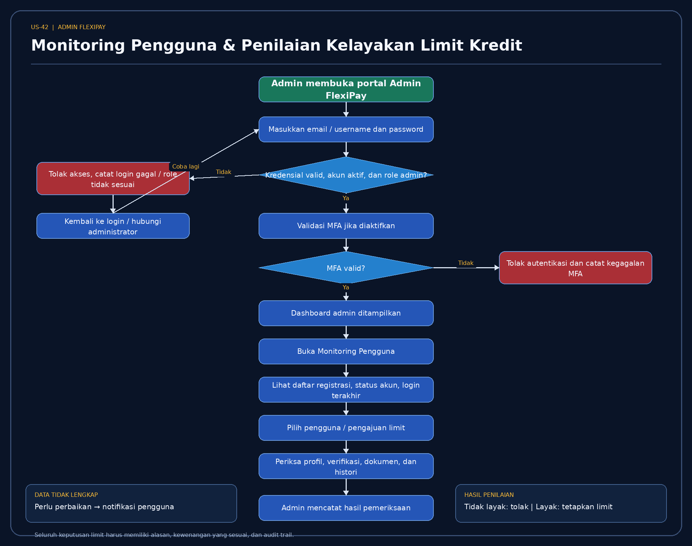

# Catatan implementasi US-42

- Portal admin berada di `/admin`, terpisah dari portal nasabah. Tidak ada pendaftaran admin publik.
- Akses awal memakai email dan PIN yang diberikan pemilik proyek. Nilai konfigurasi disimpan lokal di `.env.local` (diabaikan Git), sedangkan PIN di database disimpan sebagai hash scrypt. Jika server sudah berjalan saat konfigurasi ditambahkan, restart server agar Next.js memuat variabelnya.
- Sesi admin memakai cookie `HttpOnly`, masa berlaku delapan jam, dan token sesi yang disimpan sebagai hash. Login gagal dicatat; delapan kegagalan dalam 15 menit memblokir percobaan berikutnya untuk sementara.
- Dashboard membaca data pengguna, tanggal registrasi, status akun, login berhasil, dan logout dari database yang sama dengan autentikasi nasabah. Password, PIN, dan token tidak ditampilkan.
- Review kelayakan disimpan sebagai riwayat dengan alasan dan audit trail. Nominal hanya dapat diisi untuk status “Layak”.
- Proyek belum mempunyai formulir pengajuan kredit, KYC, data penghasilan, dokumen, atau kebijakan limit. Karena itu UI menandai data tersebut belum tersedia dan keputusan review saat ini hanya catatan prototipe; limit belum diaktifkan dan notifikasi belum dikirim.
- Karena pemilik proyek meminta PIN untuk login admin, portal memakai PIN enam digit, bukan kata sandi seperti alur generik dalam dokumen. Hak akses seed adalah `super_admin`; daftar registrasi admin tetap tidak tersedia.

Flowchart sumber: 
