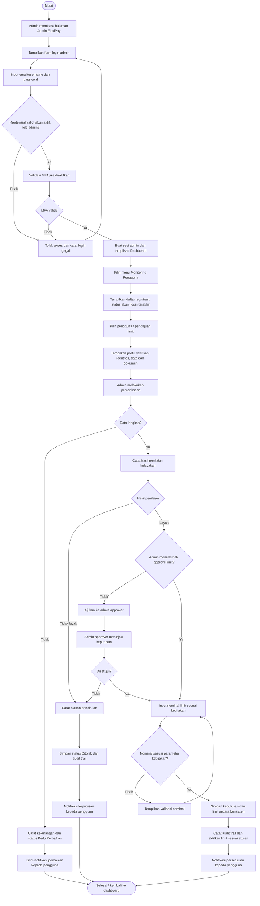

# UF-42 — User Flow Halaman Admin FlexiPay

**User Story:** US-42 — Halaman Admin untuk monitoring registrasi, login, dan penilaian kelayakan limit kredit.

## Tujuan
Menggambarkan proses admin FlexiPay login secara khusus, memantau pengguna yang registrasi/login, memeriksa pengajuan limit, dan mencatat keputusan kelayakan serta nominal limit sesuai kewenangan.

## 1. Flowchart Mermaid

## 2. Ringkasan Alur

1. Admin membuka halaman Admin FlexiPay.
2. Admin login menggunakan akun internal.
3. Backend memvalidasi password, status akun, role, dan MFA bila diterapkan.
4. Sistem menolak pengguna biasa atau akun admin nonaktif.
5. Admin masuk dashboard dan membuka Monitoring Pengguna.
6. Admin melihat daftar registrasi, status akun, serta login terakhir/riwayat login.
7. Admin memilih pengguna yang mengajukan limit.
8. Sistem menampilkan profil, status verifikasi, data pengajuan, dan dokumen pendukung.
9. Admin memeriksa kelengkapan serta kelayakan.
10. Jika data kurang, admin meminta perbaikan.
11. Jika tidak layak, admin menolak dengan alasan.
12. Jika layak, admin yang berwenang menetapkan nominal limit sesuai kebijakan.
13. Sistem menyimpan keputusan, limit, dan audit trail.
14. Sistem mengirim notifikasi status kepada pengguna.

## 3. Titik Validasi

- Role admin diperiksa di backend untuk setiap endpoint admin.
- Pengguna biasa tidak dapat mengakses halaman maupun API admin.
- Hanya role yang memiliki permission yang dapat menilai atau menyetujui limit.
- Nominal limit mengikuti parameter kebijakan yang berlaku.
- Registrasi/login tidak otomatis membuat limit aktif.
- Keputusan, perubahan limit, dan akses dokumen dicatat sesuai kebutuhan audit.
